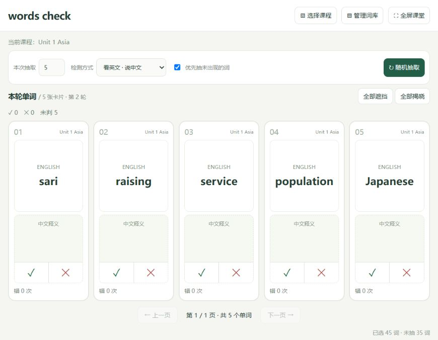

<div align="center">

# words check

**为课堂投屏设计的轻量单词抽查工具**

Excel 分课程导入 · 五词一页 · 中英互译 · 点击判分 · 错词统计

[下载 Windows 解压版](https://github.com/chenccgle-ship-it/words-check/releases/latest) · [使用指南](docs/使用指南.md) · [反馈问题](https://github.com/chenccgle-ship-it/words-check/issues)


</div>



选好课程，一次抽取几个词，让学生口头作答。老师点击左侧 **✓** 或右侧 **✕**，揭晓答案并记录结果。每页最多显示五张卡片，课堂操作集中在一个屏幕内。

## 直接使用

无需安装 Node.js 或其他开发工具。

1. 打开 [Releases 下载页面](https://github.com/chenccgle-ship-it/words-check/releases/latest)，下载 **Windows x64 ZIP**。
2. 右键压缩包 → **全部解压**。
3. 打开文件夹，双击 **启动 words check** 快捷方式。
4. 默认浏览器会自动打开，开始抽查。

不要在 ZIP 内直接启动，也不要只复制快捷方式。快捷方式无法打开时，可双击同目录的 `启动 words check.vbs`。

> 便携版适用于 Windows 10 / 11 x64。软件、Excel 读写组件及运行环境均随包提供，日常使用无需联网。

## 可以做什么

| 功能 | 使用方式 |
| --- | --- |
| 多课程单词库 | 手动录入或导入 Excel，每个工作表对应一个课程 / 单元 |
| 导入预览 | 选择课程后再确认；忽略空白行，跳过缺失中英文的行，过滤同课程重复词条 |
| 灵活抽查 | 一次抽取 1–50 个词；同批不重复，可优先抽未出现的词 |
| 三种检测模式 | 看英文说中文、看中文说英文、双面遮挡自由揭晓 |
| 专注展示 | 五词一页，支持上一页 / 下一页和全屏课堂 |
| 手动判分 | ✓ 变绿，✕ 变红；支持改判和撤销，重复点击不重复计数 |
| 错词统计 | 按词累计正确、错误及检测次数，导出到 Excel 独立列 |
| 词库维护 | 搜索、编辑、删除单词，删除课程，清零统计 |

## 默认词库

内置译林版九年级英语下册四单元整理词表，首次使用的统计为 **0**。

| 课程 | 条目数 |
| --- | ---: |
| Unit 1 Asia | 45 |
| Unit 2 Great people | 57 |
| Unit 3 Robots | 44 |
| Unit 4 Life on Mars | 46 |
| 合计 | **192** |

条目包含单词、短语和部分拼写 / 缩写变体。部分中文释义经过精简，教材版本与教学用法请以实际课本为准。数据来源与整理说明见 [词库说明](data/README.md)。

## Excel 格式

一个工作簿可包含多个课程页。第 1 行为表头，一行一条词汇：

| 英文单词或短语 | 中文释义 | 词性（可选） | 备注（可选） |
| --- | --- | --- | --- |
| tiring | 使人疲劳的；累人的 | adj. | |
| Chinese knot | 中国结 | | |
| take up | 占去时间或空间 | | |

前两列必填，前四列顺序固定。可在应用中下载模板，或使用仓库中的 [九年级下册单词表](data/九年级下册单词表.xlsx)。

导出的备份会额外包含 `累计错误次数`、`累计正确次数`、`累计检测次数`。导入备份时，新词条可恢复前两项累计统计，检测次数由两者相加得到。

**同名课程采用追加规则，不覆盖已有词条的统计。** 换电脑恢复整份备份时，请先删除目标电脑上对应的默认课程，再导入备份，避免同名词条的零统计被保留。

## 数据保存

- 词库和累计统计保存在当前浏览器的 `localStorage` 中；应用不会主动上传单词或检测记录。
- 关闭网页或重启电脑后，在同一浏览器、同一地址打开可继续使用。
- 无痕窗口、换浏览器或清除浏览器数据，会影响记录保留。请定期通过 **管理词库 → 导出词库与统计** 备份。
- 统计按单词累计，当前版本不区分学生、班级或检测方向。
- 本轮卡片和揭晓状态只在当前页面中保留，刷新会重新抽取；累计统计不受影响。
- 清零统计会保留单词；删除课程会同时删除该课程的单词和统计。

## 开发运行

源码使用原生 HTML / CSS / JavaScript，无需安装 npm 依赖。准备 Node.js 22 或更高版本后：

```sh
git clone https://github.com/chenccgle-ship-it/words-check.git
cd words-check
npm start
```

打开 `http://127.0.0.1:18765/`。Windows 上会自动打开默认浏览器；其他平台请手动访问该地址。

```sh
npm test                # 判分、改判、分页、持久化、Excel 和课程删除检查
npm run generate        # 从 data/ 重新生成默认词库
npm run build:portable  # 在 Windows x64 上构建解压即用 ZIP
```

构建产物在 `dist/`，已排除在 Git 跟踪之外。开发与打包细节见 [开发说明](docs/开发说明.md)。

## 项目结构

```text
app/          页面、样式、交互及离线 Excel 组件
data/         默认词库、Excel 文件与来源说明
scripts/      本地服务、词库生成和 Windows 打包
tests/        自动化行为检查
docs/         使用指南、开发说明和界面截图
third-party/  第三方运行环境许可
```

## 反馈与贡献

欢迎通过 Issues 反馈问题或提出课堂使用建议。反馈时请提供操作步骤、预期结果、实际结果，以及 Windows / 浏览器版本；截图请先移除学生个人信息。

修改代码前可阅读 [贡献指南](CONTRIBUTING.md)。开发计划和已发布变化见 [CHANGELOG](CHANGELOG.md)。

## 许可

本项目原创代码采用 [MIT License](LICENSE)。SheetJS 使用 Apache-2.0 许可，便携版包含的 Node.js 保留其完整许可文件。第三方组件及默认词库不因项目代码采用 MIT 而改变原有权利归属，见 [第三方说明](THIRD_PARTY_NOTICES.md)。
